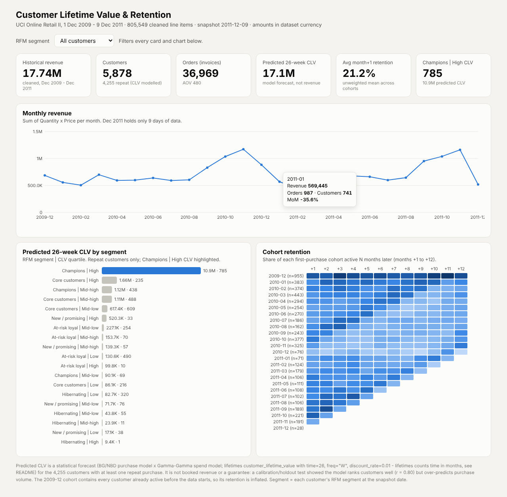

# Customer Lifetime Value & Revenue Analytics - Online Retail II

**Python · SQL (SQLite) · lifetimes (BG/NBD, Gamma-Gamma) · Power BI-ready star schema**

> **Business question:** which customers of a UK online gift-ware retailer are worth the most
> going forward, and where should a retention team spend its effort?



## Headline findings

| | |
|---|---|
| Transactions processed | **1,067,371** raw rows → **805,549** usable rows, **5,878** customers, **36,969** invoices |
| Historical revenue (Dec 2009 - Dec 2011) | **17,743,429.18** (dataset currency) |
| Repeat customers modelled (Gamma-Gamma) | **4,255** |
| Predicted 26-week CLV (project metric, see [definition](#method-summary)) | **17.10M** total · mean 4,019.85 · median 1,511.36 |
| Champions + High CLV | **785** customers (13.4 % of customers) · **10.90M** predicted CLV (63.7 % of the total) · 10.85M historical revenue (61.2 %) |
| Average cohort retention | month+1 **21.17 %** · month+3 **21.62 %** · month+6 **17.82 %** |
| Single-purchase customers (CLV not modelled) | **1,623** (27.6 %) |

What this means for a retention team:
- **Protect the 785 Champions + High CLV customers.** They bought recently (median 10 days
  before the snapshot), often (median 15 invoices), and the model gives them a median 99 %
  probability of still being active. Losing a few of them costs more than losing hundreds of others.
- **Win back the 80 At-risk loyal customers with High / Mid-high CLV.** They used to buy
  often but have gone quiet. Median probability alive is 78 %, so many are still reachable.
- **Convert single-purchase customers.** 27.6 % of customers bought once. CLV is not modelled
  for them; a second-order offer is the lever.
- Retention drops to about one customer in five after the first month and stays there, so
  most of the value sits in a small group of loyal repeat buyers.

All figures come from files in `outputs/` and `powerbi/` (see `outputs/headline_facts.csv`).
`python verify.py` re-checks them: **65 of 65 checks passed**.

## How to run

```bash
git clone <this repo> && cd clv-retail-analytics
python -m venv .venv && source .venv/bin/activate     # Windows: .venv\Scripts\activate
pip install -r requirements.txt                       # tested on Python 3.11
# download online_retail_II.xlsx into data/ (see data/README.md)
python run_all.py                                     # ~1 min first time (xlsx read), ~20 s after
python verify.py                                      # prints PASS/FAIL per number
```
Open `dashboard.html` in any browser (single file, works offline), or
`clv_analysis.ipynb` for a guided walkthrough with saved outputs.

## Repository structure

```
clv-retail-analytics/
├── run_all.py               # runs every step in order, then verify.py
├── verify.py                # checks every headline number (PASS/FAIL with tolerance)
├── dashboard.html           # self-contained interactive dashboard (aggregates only)
├── clv_analysis.ipynb       # walkthrough notebook, outputs saved
├── src/
│   ├── ingest.py            # read the 1M-row xlsx once -> CSV
│   ├── clean.py             # Step 1: cleaning rules + cleaning log
│   ├── run_sql.py           # Step 2: SQLite load, run named queries, SQL-vs-pandas parity check
│   ├── rfm_cohort.py        # Step 3: RFM scores/segments, cohort retention & revenue
│   ├── models.py            # Step 4: BG/NBD + Gamma-Gamma, CLV, quartiles, combined segments
│   ├── sanity.py            # Step 5: parameters, calibration/holdout test, independence check
│   ├── charts.py            # Step 6: matplotlib charts -> docs/
│   ├── export_powerbi.py    # Step 7: star-schema CSVs -> powerbi/
│   ├── build_dashboard.py   # Step 8: dashboard.html
│   └── headline_facts.py    # derived figures quoted in this README
├── sql/clv_analysis.sql     # CTEs + window functions (ROW_NUMBER, NTILE, LAG, RANK, running SUM)
├── outputs/                 # small result CSVs (+ outputs/sql/ query results)
├── powerbi/                 # star-schema CSVs, DAX_measures.md, BUILD_GUIDE.md, clv_theme.json
├── docs/                    # chart PNGs + dashboard preview
├── reference/               # small copies of the original project's output tables (verify targets)
└── data/                    # raw + large generated files (git-ignored, see data/README.md)
```

## Method summary

| Step | What | Key rule |
|---|---|---|
| Cleaning | 1,067,371 → 805,549 rows | drop missing Customer ID (243,007), cancellation invoices starting "C" (18,744), Quantity ≤ 0 or Price ≤ 0 (71). 26,124 exact duplicate rows are **detected and kept**: the source does not prove repeated identical lines are errors. Revenue = Quantity × Price. |
| RFM | per customer | one invoice = one purchase. Recency = days from last purchase day to snapshot (2011-12-09); Frequency = distinct invoices; Monetary = revenue. Quintile scores via `rank(method="first")` + `qcut(5)` on a table sorted by Customer ID (deterministic ties); R reversed (5 = most recent). |
| RFM segments | first rule that matches | Champions R≥4, F≥4, M≥4 · At-risk loyal R≤2, F≥3 · New / promising R≥4, F≤2 · Hibernating R≤2, F≤2 · else Core customers |
| Cohorts | first-purchase month | retention = active customers in month N ÷ cohort size; averages are unweighted means across cohorts |
| BG/NBD | all 5,878 customers | frequency = invoices − 1; recency and T in weeks (whole days ÷ 7; T floored at 0.01 for the one customer who first bought on the snapshot day); `BetaGeoFitter(penalizer_coef=0.001)` |
| Gamma-Gamma | 4,255 repeat customers | frequency > 0 and average order value > 0; `GammaGammaFitter(penalizer_coef=0.001)` |
| CLV ("26-week CLV") | repeat customers | `ggf.customer_lifetime_value(bgf, frequency, recency, T, AOV, time=26, freq="W", discount_rate=0.01)` |
| CLV segments | quartiles | customers at or above the 25th / 50th / 75th percentile of predicted CLV move up a bucket: Low / Mid-low / Mid-high / High. Single-purchase customers: "Single-purchase / CLV not modeled", CLV null. |
| Combined segment | | `RFM_Segment + " \| " + CLV_Segment` |

**What the models are.** BG/NBD and Gamma-Gamma are *probabilistic statistical models*. Their few
parameters (r, α, a, b and p, q, v) are estimated by maximum likelihood from each customer's
purchase history. They are not machine-learning models trained on features.

**SQL layer.** `sql/clv_analysis.sql` rebuilds RFM scores, segments, cohort retention, monthly
revenue (running total and month-over-month change with `LAG`), top-10 customers (`RANK`) and
segment summaries in SQLite. `run_sql.py` checks them against pandas: **all 12 parity checks
pass**. A plain `NTILE(5)` would put 3 customers in a different R, F and M score from pandas,
because NTILE sizes its buckets differently from `qcut`. So the SQL computes qcut's exact bin edges.

## Model checks (`src/sanity.py`)

- **Fitted parameters:** BG/NBD r = 0.613, α = 6.911, a = 0.097, b = 1.335; Gamma-Gamma
  p = 12.476, q = 0.941, v = 12.309 (`outputs/model_params.csv`).
- **Calibration / holdout:** fit on data before 2010-12-05, predict the next 52.7 weeks:

  | Repeat purchases in calibration | Customers | Avg actual | Avg predicted | Error |
  |---|---|---|---|---|
  | 0 | 1,429 | 0.89 | 2.01 | +127 % |
  | 1 | 820 | 1.54 | 3.04 | +98 % |
  | 2 | 511 | 2.09 | 3.90 | +87 % |
  | 3-4 | 625 | 3.33 | 5.21 | +57 % |
  | 5-9 | 589 | 5.34 | 7.63 | +43 % |
  | 10+ | 317 | 16.74 | 19.75 | +18 % |
  | **All** | **4,291** | **3.29** | **4.98** | **+51 %** |

  The model **ranks customers well** (correlation between predicted and actual 0.80) but
  **over-predicts purchase volume**, most of all for low-frequency customers. Use CLV to rank and
  prioritise customers, not as a revenue forecast.
- **Gamma-Gamma independence assumption:** correlation between purchase frequency and average
  order value among repeat customers is 0.03 (Pearson) / 0.19 (Spearman). That is weak, so the
  assumption roughly holds.

## Limitations

- **CLV horizon units.** `lifetimes` documents the `time` argument in **months** and
  `discount_rate` as monthly. With `freq="W"` it steps 4.345 weeks per period, so `time=26`
  covers ~113 weeks of expected purchases. The project keeps the original metric so its
  numbers reproduce exactly. The same model with `time=6` (~26 weeks) gives 4.51M in total and
  782 Champions + High CLV customers with 2.86M. Customer ranking is unchanged (Spearman 0.9999).
  See `outputs/clv_horizon_check.csv`.
- **The model over-predicts volume in a holdout test** (+51 % overall). Predicted CLV is a model
  forecast for repeat customers, not revenue and not a guarantee.
- **Left-censoring:** the data starts on 1 Dec 2009, so the "2009-12 cohort" contains every
  customer who was already active before then. Its retention (35 % at month+1) is not a true
  new-customer cohort.
- **December 2011 is partial** (1-9 Dec), so the last month looks like a drop.
- Returns and cancellations are excluded rather than netted against sales. Revenue is gross of
  returns.
- Single-purchase customers (27.6 %) get no modelled CLV. BG/NBD still gives them a
  purchase forecast and a probability alive.
- Segments use each customer's status at the snapshot date, so cohort retention filtered by
  segment looks back with knowledge of today's segment.
- Exact duplicate lines (26,124) are kept. If they were data-entry duplicates, revenue would
  be overstated.

## Rebuild notes - differences from the original project

This repo is a clean rebuild of an earlier project whose output tables are stored in
`reference/`. Every number matches; the differences below are documented choices.
- The original outputs used `" | "` as the combined-segment separator, but the original script
  used `" + "`. This repo uses `" | "` to match the outputs.
- The original outputs define At-risk loyal as R≤2 **and F≥3**; the original script said F≥4
  (that would move 471 customers to Core customers). This repo follows the outputs.
- CLV quartiles use "at or above the percentile" boundaries, as in the outputs. The original
  script's `qcut(rank)` would place one customer (the exact median, ID 14522) one bucket lower.
- recency and T use whole days ÷ 7, as in the outputs. The original script used exact
  timestamps against a midnight snapshot, which would drop customers who bought on the last day.
- The predicted CLV total differs from the original by less than 1e-12 relative (optimiser
  rounding).

## Power BI

There is **no .pbix file** in this repo. A .pbix can only be built in Power BI Desktop
(Windows). `powerbi/` contains the star-schema tables, `DAX_measures.md`, a theme and
`BUILD_GUIDE.md` for a 4-page report (Overview, Segments, Cohort Retention, CLV and Retention
Strategy). The transaction fact table (~80 MB) is regenerated into `data/` by `run_all.py`.

## Data

UCI Machine Learning Repository - *Online Retail II* (Chen, 2012), CC BY 4.0.
https://archive.ics.uci.edu/dataset/502/online+retail+ii

---
Built with AI assistance; I can run, explain and modify every part.
